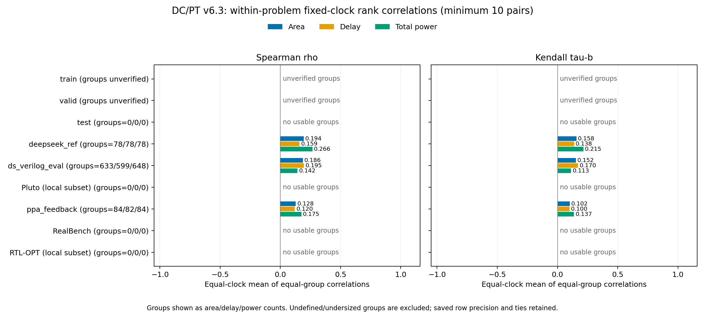
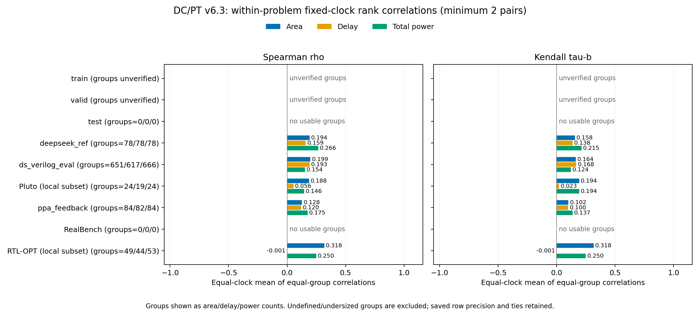

# In-group PPA ranking evaluation

The central question is whether the estimator can rank alternative implementations
of the **same intended problem at the same recorded clock target**. This is
different from recognizing that unrelated large designs usually have larger PPA
values than unrelated small designs. Pooled split correlations can be high even
when ordering alternatives within each problem is poor.

These results are post-hoc analysis of the retained DC/PT v6.3 standalone
prediction records. No new inference, training or optimization search was run.
Predictions use the recorded 16-draw median procedure, and targets remain at the
saved formatter precision. They assess ranking on saved alternatives; they do
not establish a measured search improvement.

## Recorded in-group results

With the historical **minimum ten decoded finite records** per problem/clock,
the three candidate-rich sets show macro Spearman values of approximately
**0.12–0.27** and Kendall tau-b values of **0.10–0.21**. The recorded model's
strong pooled correlations therefore do not translate into strong ordering of
alternatives in these groups. This supports a limitation of the retained model
on these saved candidates; it does not identify the cause or quantify search outcomes.

| Split | Usable groups (area/delay/power) | Area rho | Area tau-b | Delay rho | Delay tau-b | Power rho | Power tau-b |
|---|---:|---:|---:|---:|---:|---:|---:|
| `train` | unverified | N/A | N/A | N/A | N/A | N/A | N/A |
| `valid` | unverified | N/A | N/A | N/A | N/A | N/A | N/A |
| `test` | 0/0/0 | N/A | N/A | N/A | N/A | N/A | N/A |
| `test_deepseek_ref` | 78/78/78 | 0.1939 | 0.1577 | 0.1594 | 0.1380 | 0.2662 | 0.2149 |
| `test_ds_verilog_eval` | 633/599/648 | 0.1863 | 0.1523 | 0.1951 | 0.1703 | 0.1418 | 0.1128 |
| `test_pluto` | 0/0/0 | N/A | N/A | N/A | N/A | N/A | N/A |
| `test_ppa_feedback` | 84/82/84 | 0.1279 | 0.1023 | 0.1201 | 0.0996 | 0.1750 | 0.1370 |
| `test_realbench` | 0/0/0 | N/A | N/A | N/A | N/A | N/A | N/A |
| `test_rtl_opt` | 0/0/0 | N/A | N/A | N/A | N/A | N/A | N/A |

All defined coefficients above use six clock means. `N/A` means either unverified
membership (train/valid), singleton task groups (`test`/RealBench), or no group
large enough for this cutoff (Pluto/RTL-OPT). It is not a zero coefficient.
Group counts sum problem/clock groups, not unique problems. The threshold counts
records rather than guaranteed unique RTL implementations; repetition and
membership-match coverage are reported separately.

### Smaller benchmark subsets

| Local subset | Minimum pairs | Usable groups (area/delay/power) | Area rho / tau-b | Delay rho / tau-b | Power rho / tau-b |
|---|---:|---:|---:|---:|---:|
| Pluto | 3 | 24/19/24 | 0.1875 / 0.1944 | 0.0559 / 0.0229 | 0.1458 / 0.1944 |
| RTL-OPT base/reference pairs | 2 | 49/44/53 | 0.3181 / 0.3181 | -0.0007 / -0.0007 | 0.2500 / 0.2500 |

Pluto has only three alternatives per problem/clock; RTL-OPT's recovered pairs
have only two. Their mean correlations are weak, with almost no delay association
in the recovered RTL-OPT pair cohort. Two-record coefficients are discrete
ordering scores, and these small subsets do not satisfy the ten-record policy.
The machine-readable tables also contain all 2-, 3- and 10-record policies for
the recovered sets, without selecting a cutoff to improve the headline result.





Public files contain only aggregates:

- [All split/metric/cutoff summaries](../results/v6.3/in-group-rank-summary.csv) and [JSON](../results/v6.3/in-group-rank-summary.json).
- [Numeric-clock aggregates](../results/v6.3/in-group-rank-per-clock.csv) and [JSON](../results/v6.3/in-group-rank-per-clock.json).
- [Group reconstruction coverage](../results/v6.3/group-reconstruction-coverage.json).
- [Uniform-constraint sensitivity](../results/v6.3/in-group-constraint-sensitivity.csv) and [JSON](../results/v6.3/in-group-constraint-sensitivity.json).

## Definition and aggregation

1. Recover an intended problem/family identifier from verified source metadata
   or benchmark task relationships. Keep different problems and widths separate.
2. Partition each problem by recorded clock, rounded to nine decimal places.
3. For each PPA metric separately, retain pairs with finite prediction and target.
   Finite zero targets remain. Apply the stated minimum group size to these pairs.
4. Compute Spearman rho using average ranks for exact ties, and Kendall **tau-b**
   with tie correction. Constant targets or predictions have undefined coefficients.
5. Average defined group coefficients equally within each clock, then average
   defined clock means equally. Larger groups do not receive more weight. Clocks
   with no defined group coefficient are omitted and counted.

The retained historical analysis implementation defaults to a minimum of **10** examples per
problem/clock group. The main table uses that cutoff; supplementary policies at
**2 and 3** show what can be measured on smaller benchmark subsets. A two-element
nonconstant group yields only +1 or -1, so RTL-OPT pair results express directional
ordering rather than a rich ranking of many alternatives. No small-group result
is relabeled as satisfying the historical ten-example policy.

The new helper uses exact constancy, consistent with its exact rank/tie semantics.
Some historical scripts excluded nearly constant arrays with absolute tolerance
`1e-12` and excluded only NaNs. This analysis excludes all nonfinite pairs and
reports its own recovered memberships. It is a documented reconstruction, not a
claim to reproduce an originally logged grouped score.

An independent recomputation found that exact constancy and the historical
`1e-12` rule give identical aggregate coefficients and exclusion counts on these
retained records. The weak scores are not caused by changing that rule.

Undefined and undersized groups are excluded from the means and counted in the
aggregate files. In particular, a constant prediction can prevent useful ranking;
omitting its undefined coefficient must not be mistaken for successful ranking.
The conditional macro means should be read together with usable-group counts.
Failed decodes were already absent from saved CSVs; their split-level counts
remain in the [standalone results](V63_RESULTS.md#standalone-prediction-evaluation).
No significance tests or independence assumptions are made.

## Recovering group identities

The saved prediction CSVs have blank `family_id` fields. Group membership is
reconstructed separately; blank fields are not filled by arbitrary clustering.
Test-set lineage IDs hash individual RTL implementations, so they cannot identify
families of alternative implementations. Training/validation name collisions
must likewise not be treated as evidence of an optimization family.

Pluto contributes four intended tasks, each with three variants at each of six
clock targets: **24 groups of three**. RTL-OPT has nine explicit base/reference
task pairs: **54 groups of two**. Its remaining tasks are singletons per clock;
the one failed decode belongs to a singleton. The multi-variant benchmark groups
have distinct normalized RTL implementations and matching normalized SDC and
`has_clock`. Different adder/comparator/divider categories or widths are not
combined. Correct benchmark origins and subset limits are in the
[reference guide](BENCHMARK_REFERENCES.md).

These relationships establish intended alternatives, not a newly recovered
formal-equivalence proof. Functionally invalid implementations, incomplete
measurement histories or group provenance gaps remain possible limitations.

### Generated sets and match coverage

The generated DeepSeek, VerilogEval and PPA-feedback implementation names encode
the task before the first double underscore, followed by generation/candidate
information. This relationship is corroborated by the retained collection code
and source rows. It is used during this private reconstruction; the public
launcher still requires explicit group IDs and does not apply a naming heuristic.

Every retained test prediction matches source metadata by recorded design name,
clock and all three formatter-rounded ground-truth values. No match assigns
different intended families. Some repeated source records match the same saved
prediction, so this is not a universal one-to-one record join:

| Test set | Matched decoded rows | Fixed-clock groups | Rows matching multiple source records in the same family | Extra repeated normalized RTL records within source groups |
|---|---:|---:|---:|---:|
| `test` | 810 | 810 | 0 | 0 |
| `test_deepseek_ref` | 13,172 | 90 | 4,272 | 3,996 |
| `test_ds_verilog_eval` | 45,911 | 876 | 9,319 | 7,384 |
| Pluto | 72 | 24 | 0 | 0 |
| `test_ppa_feedback` | 14,206 | 90 | 0 | 294 |
| RealBench | 515 | 515 | 0 | 0 |
| RTL-OPT | 287 | 233 | 0 | 0 |

All source candidates for a multiply matched generated prediction also share the
same normalized RTL. The last column counts source records beyond distinct
whitespace-normalized RTL within each problem/clock group; it is not the number
of excluded predictions. These repeats are retained in the primary historical
record-based analysis. No arbitrary averaging, selection or prediction
deduplication is performed. Whitespace normalization does not prove semantic
equivalence, and repeated observations do not constitute independent alternatives.

### Constraint sensitivity

The primary historical partition fixes the **nominal recorded clock**. Six
groups in each of the DeepSeek and generated VerilogEval sets contain unequal
SDC/`has_clock`: one candidate for a task has a real `clk` port while other
records use a virtual clock. These are substantive differences. There are no
such group differences in the PPA-feedback, Pluto or RTL-OPT selections.

A strict sensitivity drops each entire mixed-constraint task/clock group,
retaining the ten-record cutoff and the original records in remaining groups.
It removes 1,050 DeepSeek rows and 360 generated VerilogEval rows. The affected
DeepSeek groups and generated VerilogEval area/delay groups were already
undefined in the primary means, so those coefficients do not change. Removing
one usable VerilogEval power group changes its rho from **0.1418 to 0.1412** and
tau-b from **0.1128 to 0.1123**; the other five mixed-constraint power groups were
already undefined. PPA-feedback scores remain unchanged. The
[strict sensitivity tables](../results/v6.3/in-group-constraint-sensitivity.csv)
provide all counts and differences. This check preserves the conclusion of weak
ranking on these records without claiming complete constraint or functionality
verification of every candidate.

## Recompute with explicit groups

Use a private CSV containing verified `group_id`, numeric `clock` and the six
scalar columns `gt_area`, `pred_area`, `gt_delay`, `pred_delay`, `gt_total_power`
and `pred_total_power`. Every row must be an already decoded prediction. Do not
substitute unrounded dataset targets or infer families merely from similar names.

```bash
python scripts/summarize_grouped_rank_correlations.py --input test_pluto=/path/to/grouped-predictions.csv --group-column group_id --clock-column clock --min-group-size 10 --min-group-size 3 --min-group-size 2 --per-clock --output /path/to/new-grouped-summary
```

Repeat `--input SPLIT=CSV` for additional splits. The default minimum is 10 and
the default group column is `family_id`; blank IDs fail explicitly. The installed
alias is `rtl-ppa-grouped-rank-summary`. Outputs contain split/metric aggregates
and optionally numeric-clock aggregates. Group identities, design records,
input paths and per-group coefficients are not exported.

The ordinary maintained evaluator preserves a supplied `family_id` in its local
prediction CSV. The grouped utility requires independently verified membership
and never silently derives it from the pooled results or dataset lineages.
For the new aggregate plot, use:

```bash
python scripts/plot_grouped_rank_correlations.py --input /path/to/in-group-rank-summary.csv --min-group-size 10 --output /path/to/new-grouped-figures
```
