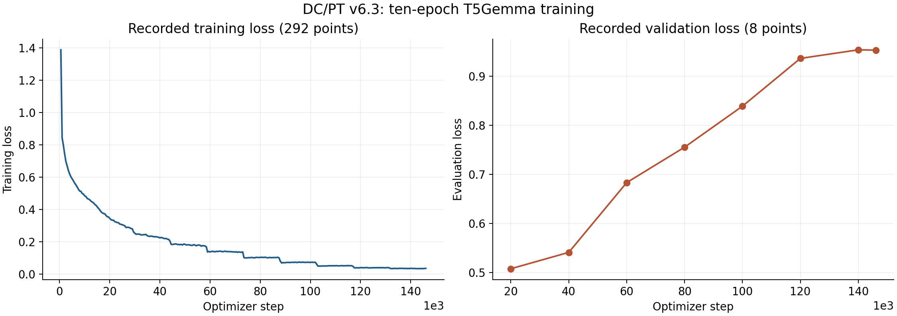
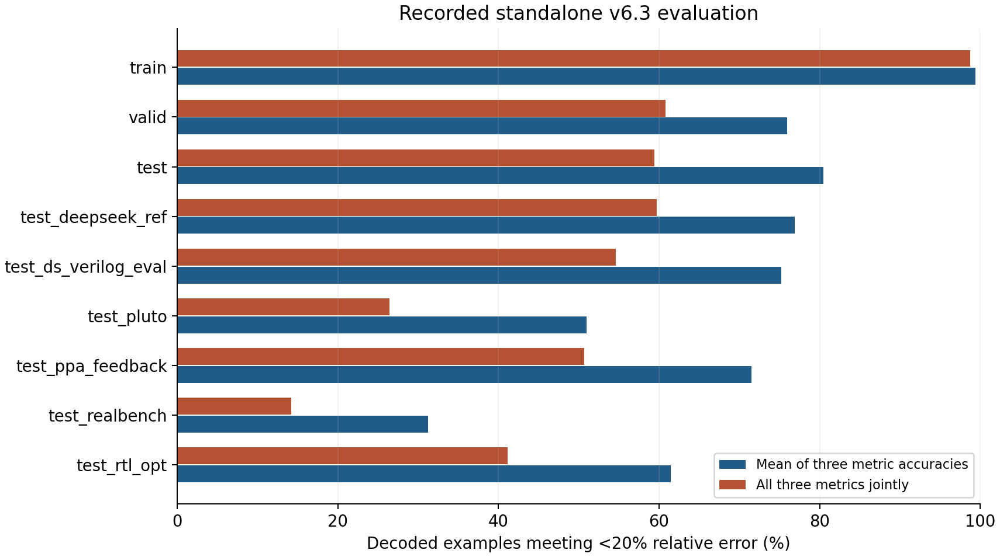
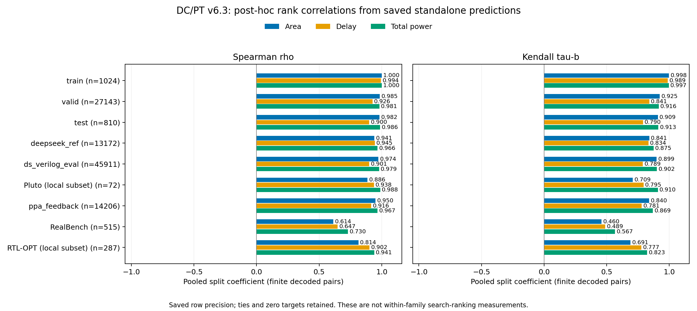

# Recorded DC/PT v6.3 training and evaluation

The [dataset construction and source-distribution tables](DATASET_GENERATION.md) document the recorded base/augmentation mixture and all eleven retained split sizes. They describe dataset rows separately from the prediction-evaluation denominators below.

These are recorded standalone results for the Design Compiler / PrimeTime v6.3.0 PPA model. They are published as aggregate evidence. Datasets, design-level predictions and checkpoints are not included. No retained evidence establishes that this v6.3 model was evaluated inside optimization search. The measurements do not demonstrate a search improvement or a controlled improvement over earlier model versions.

The [cohort mapping](IN_GROUP_EVALUATION.md) distinguishes the two overlapping
REvolution/DeepSeek search cohorts from the researcher's PPA-guided search
candidates. Run logs identify the latter's earlier guiding proxy as a `v6.1.4`
T5Gemma small model named for five epochs, without a cryptographic association
to every retained candidate. The final model's predictions on these saved
candidates are retrospective standalone evaluation, not evidence that it guided
the original searches. The cohorts are not claimed as independent test sources.

The [project findings](PROJECT_FINDINGS.md) call this the **final CE PPA model**
and distinguish its standalone results from earlier-model loss/search evidence.
The generated evaluation cohorts belong to the **Same-Task RTL Ranking Suite**;
their [reader-facing names and unchanged split identifiers](IN_GROUP_EVALUATION.md)
describe intended alternatives, not a guarantee of functional equivalence or
verified train/test independence. The [historical CE/NTL comparison](HISTORICAL_LOSS_COMPARISON.md)
does not use this final model.

## Training provenance

The selected T5Gemma large encoder/decoder model completed **10 epochs and 146,040 optimizer steps**. The base model family was `google/t5gemma-l-l-prefixlm`; its exact revision and the complete original launch command were not recorded. The imported regress-lm source revision was also not recorded. These gaps limit exact reproduction.

| Recovered setting | Value |
|---|---:|
| Initial learning rate | 0.00001 |
| Training batch size per device | 4 |
| Evaluation batch size per device | 4 |
| Gradient accumulation steps | 8 |
| Weight decay | 0.01 |
| Seed | 42 |
| Precision | BF16 |
| Optimizer | AdamW fused (PyTorch) |
| Learning-rate schedule | Linear |
| Evaluation interval | 20,000 steps |
| Save interval | 2,000 steps |
| Maximum input length | 3,072 tokens |
| Maximum target length | 128 tokens |
| Prediction sampling | 16 draws, component-wise median of valid draws |
| Scientific-notation precision setting | 4 |

The saved training arguments support the optimization settings above. The retained formatter and compatible launch profile supply the formatting/sampling settings; the full original invocation is unavailable. The retained training implementation uses a 0.1 warmup ratio and caps its loss-evaluation dataset at **1,024 validation examples**. This training-time loss measurement is different from the standalone prediction evaluation on full saved validation splits. The recovered maintained training code uses token cross-entropy. These final-model results must not be attributed to Number Token Loss.

## Recorded loss curves



The public history contains **292 training-loss points and 8 evaluation-loss points**, including the final evaluation at step 146,040. It preserves only step, epoch, training loss, evaluation loss and learning rate from each recorded log entry. Missing fields remain blank in CSV and absent in JSON. Points have not been smoothed or resampled. Training loss and capped validation loss are shown on separate axes because they represent different recorded measurements. Their divergence motivates further examination; it does not isolate a cause such as overfitting or data shift.

## Standalone prediction evaluation

| Split | Decoded | Failed | Mean relative error | Mean metric accuracy <20% | All metrics <20% |
|---|---:|---:|---:|---:|---:|
| `train` | 1,024 | 0 | 0.00850522 | 99.41% | 98.73% |
| `valid` | 27,143 | 7 | 6.02803e+07 | 75.96% | 60.82% |
| `test` | 810 | 0 | 0.122938 | 80.45% | 59.38% |
| REvolution/DeepSeek search cohort A (`test_deepseek_ref`) | 13,172 | 1 | 0.160337 | 76.90% | 59.70% |
| REvolution/DeepSeek search cohort B (`test_ds_verilog_eval`) | 45,911 | 12 | 0.161441 | 75.22% | 54.60% |
| `test_pluto` | 72 | 0 | 0.269014 | 50.93% | 26.39% |
| PPA-guided search candidates (`test_ppa_feedback`) | 14,206 | 0 | 0.258567 | 71.49% | 50.70% |
| `test_realbench` | 515 | 1 | 4.80037e+09 | 31.26% | 14.17% |
| `test_rtl_opt` | 287 | 1 | 0.274675 | 61.44% | 41.11% |

| Split | Area <20% | Delay <20% | Total power <20% |
|---|---:|---:|---:|
| `train` | 99.71% | 99.51% | 99.02% |
| `valid` | 72.93% | 85.95% | 68.99% |
| `test` | 80.37% | 88.40% | 72.59% |
| REvolution/DeepSeek search cohort A (`test_deepseek_ref`) | 73.00% | 86.52% | 71.17% |
| REvolution/DeepSeek search cohort B (`test_ds_verilog_eval`) | 72.29% | 86.02% | 67.36% |
| `test_pluto` | 33.33% | 69.44% | 50.00% |
| PPA-guided search candidates (`test_ppa_feedback`) | 68.40% | 82.16% | 63.90% |
| `test_realbench` | 23.30% | 47.38% | 23.11% |
| `test_rtl_opt` | 48.43% | 81.53% | 54.36% |



The machine-readable summaries contain all saved per-metric, mean-metric and joint accuracies at **5%, 10% and 20%** relative-error thresholds, mean relative error, successfully decoded counts and failed-decode counts. The aggregate `total_samples` field is the successfully decoded denominator. `attempted_samples` is the sum of decoded and failed rows. The results were checked against reconstructed saved summaries. Split names are retained as labels; names alone do not establish family independence or absence of overlap.

The `train` prediction evaluation is limited to **1,024 examples**, so its accuracy is not an estimate for the full training dataset. Failed decodes are listed separately and excluded from the historical accuracy denominator. The mean metric accuracy averages area, delay and total-power accuracies; joint accuracy requires all three predictions in an example to pass the threshold.

The historical relative-error formula is `abs(prediction - target) / (abs(target) + 1e-10)`. Threshold tests use a strict `<`. Zero targets can dominate the mean: the saved validation results include 336 zero area labels, 585 zero delay labels and 396 zero total-power labels among decoded examples; RealBench has 9 zero labels for each metric. Their recorded mean relative errors (approximately 6.03e7 and 4.80e9) are not typical percentage errors. The available evidence does not establish whether the zero labels are valid cases or data-quality problems. They were not relabeled for this release.

The RTL-OPT and Pluto rows use selected local DC/PT remeasurements. Cite
Yao Lu et al., [*A New Benchmark for the Appropriate Evaluation of RTL Code Optimization*](https://arxiv.org/abs/2601.01765),
2026, and Manar Abdelatty et al., [*Pluto: A Benchmark for Evaluating Efficiency of LLM-generated Hardware Code*](https://arxiv.org/abs/2510.14756),
2025 arXiv version. The [benchmark reference guide](BENCHMARK_REFERENCES.md)
documents the local subsets, later Pluto venue and missing upstream revision pins.
They are not the papers' own prediction results or PPA label sets.

## In-group rank correlations

The central ranking evaluation compares alternatives for the **same intended
problem at a fixed recorded clock**. The [in-group results and method](IN_GROUP_EVALUATION.md)
report Spearman rho and Kendall tau-b, equal-group/equal-clock macro averaging,
usable-group counts and minimum-size policies. These are newly reconstructed
statistics from saved predictions, without new inference or search.

Saved `family_id` fields are blank, but retained dataset and generator/benchmark
metadata support reconstructing intended families in the seven test sets.
Training/validation family membership remains unverified. Dataset lineage hashes
identify exact RTL implementations and are not substituted for problem families.
Pluto's three-variant groups and RTL-OPT's two-variant base/reference pairs are
reported with their applicable smaller cutoffs, separately from the historical
ten-record policy. Read the reconstruction coverage and constant/undersized group
counts alongside the coefficients.

The [dataset provenance audit](DATASET_GENERATION.md#recovered-parent-provenance-limit)
also found incorrect Pyra augmentation parent hashes and true parent/child
families crossing training/validation splits. Their effect on these metrics is
unquantified. Saved-lineage zero overlap cannot establish a correct partition
when the saved parent identities are wrong.

## Post-hoc rank correlations

These coefficients were computed during release preparation from the **saved
standalone prediction CSVs**, not recovered as originally logged training
metrics. No new inference was performed. Ground truth and predictions retain the
saved formatter/CSV precision; unrounded dataset targets are not substituted.

| Split | Finite pairs per metric | Area rho | Area tau-b | Delay rho | Delay tau-b | Total power rho | Total power tau-b |
|---|---:|---:|---:|---:|---:|---:|---:|
| `train` | 1,024 | 0.9999 | 0.9977 | 0.9939 | 0.9887 | 0.9999 | 0.9966 |
| `valid` | 27,143 | 0.9847 | 0.9246 | 0.9260 | 0.8407 | 0.9812 | 0.9164 |
| `test` | 810 | 0.9818 | 0.9092 | 0.8998 | 0.7900 | 0.9864 | 0.9130 |
| REvolution/DeepSeek search cohort A (`test_deepseek_ref`) | 13,172 | 0.9414 | 0.8411 | 0.9448 | 0.8337 | 0.9659 | 0.8748 |
| REvolution/DeepSeek search cohort B (`test_ds_verilog_eval`) | 45,911 | 0.9740 | 0.8995 | 0.9007 | 0.7893 | 0.9789 | 0.9019 |
| Pluto subset (`test_pluto`) | 72 | 0.8858 | 0.7086 | 0.9382 | 0.7948 | 0.9878 | 0.9098 |
| PPA-guided search candidates (`test_ppa_feedback`) | 14,206 | 0.9502 | 0.8397 | 0.9161 | 0.7806 | 0.9667 | 0.8694 |
| `test_realbench` | 515 | 0.6139 | 0.4597 | 0.6472 | 0.4889 | 0.7300 | 0.5669 |
| RTL-OPT subset (`test_rtl_opt`) | 287 | 0.8142 | 0.6905 | 0.9024 | 0.7774 | 0.9405 | 0.8233 |



For each scalar metric, every saved row where both target and prediction are
finite receives equal weight. All 27 split/metric combinations have zero
additional nonfinite exclusions. Finite zero targets remain included. Failed
decodes were already absent from the prediction CSVs; their separate counts are
the ones reported above. `decode_fail` repeats the split-level count across three
metric rows in the machine-readable file and must not be summed over metrics.

Spearman rho is Pearson correlation of ranks, with average ranks for exact ties.
Kendall uses **tau-b**, correcting for ties in either variable. Coefficients are
undefined for constant variables or fewer than two finite pairs; the maintained
helper emits `null` and an explicit status in those cases. These conventions match
the [SciPy Spearman definition](https://docs.scipy.org/doc/scipy/reference/generated/scipy.stats.spearmanr.html)
and [Kendall tau-b definition](https://docs.scipy.org/doc/scipy/reference/generated/scipy.stats.kendalltau.html).
Round-trip numeric parsing is required: default approximate CSV float parsing
can change exact ties. The public summarizer uses `csv.DictReader` plus `float`.

These are **pooled split correlations**, across different designs, variants and
clock points. They are not averages of within-family coefficients. All retained
`family_id` columns are blank; the separate in-group analysis reconstructs
membership from retained source metadata, while this pooled table uses no groups.
Repeated designs/settings also mean rows are not independent;
no independence-based significance tests or p-values are reported. A high pooled
rank correlation can coexist with low absolute prediction accuracy and does not
demonstrate useful ranking of competing implementations of the same design.
The `train` coefficients still describe only 1,024 saved examples. No coefficient
establishes v6.3 search performance.

The maintained evaluator now appends per-metric `_spearman_rho`, `_kendall_tau_b`,
`_rank_n_pairs`, `_rank_excluded_nonfinite` and `_rank_status` fields. The existing
decoding, sampled medians, relative errors and accuracy thresholds are preserved.
You can also summarize compatible saved predictions without loading a model:

```bash
python scripts/summarize_rank_correlations.py --input test_pluto=/path/to/predictions.csv --decode-fail test_pluto=0 --output /path/to/new-rank-summary
```

Repeat `--input SPLIT=CSV` and, when known, `--decode-fail SPLIT=COUNT` for other
splits. Omitted failure counts remain unknown rather than becoming zero. The
installed alias is `rtl-ppa-rank-summary`. Outputs contain aggregate rows only;
no design identities, raw predictions or input paths are copied into them. Use
`scripts/plot_rank_correlations.py --input /path/to/rank-correlation-summary.csv --output /path/to/new-figures`
to plot a compatible aggregate table.

## Public result files

- [Training settings](../results/v6.3/training-settings.json)
- [Training history CSV](../results/v6.3/training-history.csv) and [JSON](../results/v6.3/training-history.json)
- [Evaluation summary CSV](../results/v6.3/evaluation-summary.csv) and [JSON](../results/v6.3/evaluation-summary.json)
- [Rank correlation CSV](../results/v6.3/rank-correlation-summary.csv) and [JSON](../results/v6.3/rank-correlation-summary.json)
- [Zero-target aggregate diagnostics](../results/v6.3/zero-target-summary.json)

The full original trainer-state file and all per-design evaluation records are excluded. The code release supports experiments with user-supplied compatible artifacts; it does not provide an independent public-data reproduction of these historical measurements.
